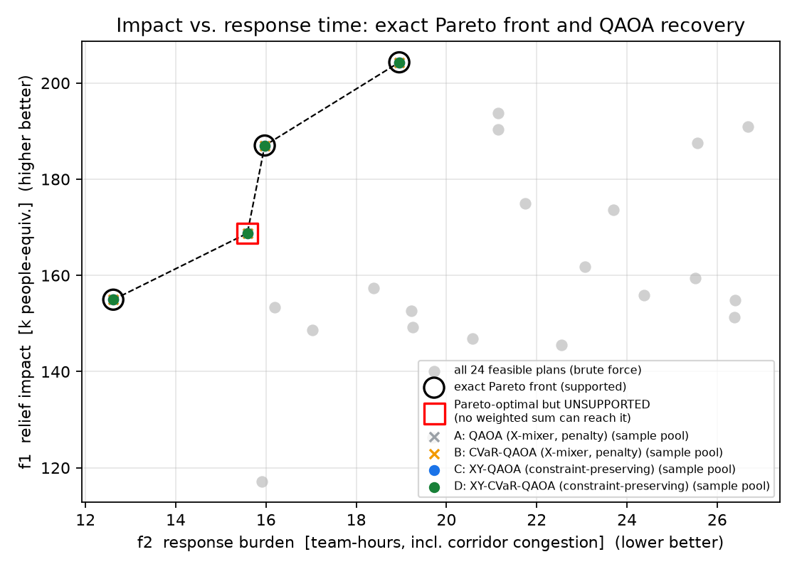
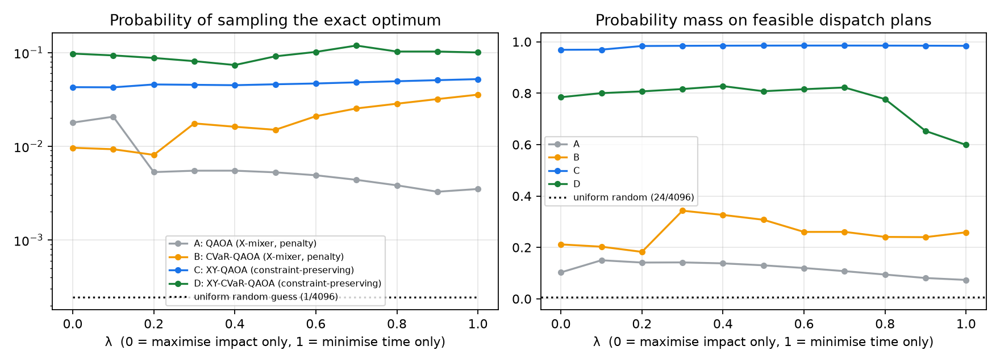
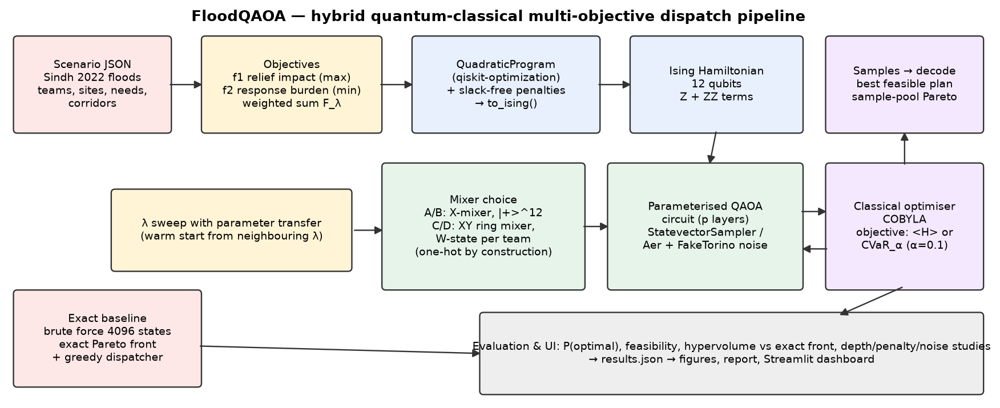

# FloodQAOA — quantum multi-objective dispatch of flood-relief teams

**Qiskit Fall Fest 2026 Hackathon · Domain 2: Disaster Response**

**Team:** Baqir Raza · M. Ali Reza · Balaaj Raza

In the **2022 Pakistan floods**, district control rooms in Sindh had to decide which scarce specialist teams
(boat rescue, mobile medical camps, relief convoys) to send to which cut-off area. The decision has
**competing objectives**:

- **reach the most people** with the team best suited to their needs,
- **respond fast**, over washed-out roads, without congesting the few surviving corridors (N-55, N-65).

There is no single correct plan, so FloodQAOA uses **QAOA in Qiskit** to compute the **trade-off curve
(Pareto front)** of dispatch plans. Every result is checked against an **exact brute-force baseline**.

> ⚠️ Places and coordinates are real (Johi, Khairpur Nathan Shah, Dadu, Jacobabad; bases at Sukkur,
> Hyderabad and Larkana). Population, need and access figures are **synthetic** and illustrative,
> not NDMA/PDMA data.

## The model (12 qubits)

| | |
|---|---|
| Variables | `x[t,s] ∈ {0,1}`: team *t* goes to site *s* (3 teams × 4 sites = **12 qubits**) |
| Objective 1 (max) | relief impact = Σ people × (team capability · site needs) · x |
| Objective 2 (min) | response burden = Σ travel hours · x + congestion × Σ x·x′ for teams sharing a corridor (**quadratic**) |
| Constraints | every team goes to exactly one site; at most one team per site, so one site waits for the second wave |
| Scalarisation | `F_λ = −(1−λ) f1/f1max + λ f2/f2max`, λ swept over 0…1 |
| Quantum mapping | `QuadraticProgram` → slack-free penalties → `to_ising()` → Z/ZZ Hamiltonian |

## Four QAOA variants (an ablation)

| | Mixer / initial state | Objective | Constraints |
|---|---|---|---|
| **A** | X-mixer, \|+⟩¹² | ⟨H⟩ | penalties |
| **B** | X-mixer, \|+⟩¹² | CVaR₀.₁ | penalties |
| **C** | **XY ring mixer, W-state per team** | ⟨H⟩ | one-hot **by construction** + capacity penalty |
| **D** | XY ring mixer, W-state per team | CVaR₀.₁ | one-hot by construction + capacity penalty |

## Results

| Variant | mean P(optimal) | × random (1/4096) | mean P(feasible) | optimum found | Pareto plans (best-per-λ / sample pool) | noisy P(opt), FakeTorino |
|---|---|---|---|---|---|---|
| **A** QAOA (X-mixer, penalty) | 0.007 | 30× | 0.12 | 10/11 λ | 3/4 · 4/4 | 0.001 |
| **B** CVaR-QAOA (X-mixer, penalty) | 0.020 | 81× | 0.26 | 11/11 λ | 3/4 · 4/4 | 0.002 |
| **C** XY-QAOA (constraint-preserving) | 0.047 | 192× | 0.98 | 11/11 λ | 3/4 · 4/4 | 0.007 |
| **D** XY-CVaR-QAOA (constraint-preserving) | 0.096 | 392× | 0.77 | 11/11 λ | 3/4 · 4/4 | 0.012 |

- **Exact baseline:** brute force over all 4096 bit-strings gives 24 feasible plans and **4 Pareto-optimal plans, one of them unsupported** (no weighted sum can reach it).
- **The constraint-preserving XY mixer + CVaR (D)** samples the exact optimum **~392× more often than random guessing** and **~13× more often than standard QAOA (A)**.
- **Fair-comparison caveat:** C/D search only the 64 one-hot states by construction. Against uniform guessing *within that space* (1/64), the QAOA training itself amplifies the optimum ~3× (C) and ~6× (D). Most of the gain over 1/4096 comes from the constraint-preserving encoding, which is the point of the design, but we report both numbers.
- Taking only the best sample per λ recovers 3/4 Pareto plans. **Pooling all QAOA samples recovers 4/4, including the unsupported plan.**
- **Classical greedy dispatcher** (best pair first): optimal at only 5/11 λ values (mean normalised gap 0.16).
- **Noise:** on an IBM FakeTorino noise model (~370–394 CZ gates) all variants degrade sharply, though D still samples the optimum ~49× above random.






## Quick demo (1 minute)

Open **`demo.ipynb`**. It is executed with outputs, and GitHub renders it. It builds the Ising model, runs XY-CVaR-QAOA in
Qiskit, and checks the result against brute force (P(optimal) = 0.091 vs 1/64 random, matching the exact optimum).

## Testing

58 pytest + 11 Vitest + 10 Playwright tests run in CI on every push. They cover unit, property-based (Hypothesis),
cross-implementation (vs qiskit-optimization and vs Qiskit statevectors), regression, reproducibility, integration,
E2E, accessibility (axe-core, WCAG AA), performance budget, responsive and security (pip-audit / npm audit).
See **[docs/TESTING.md](docs/TESTING.md)**. Prepared answers to likely judge questions: **[docs/DEFENSE_QA.md](docs/DEFENSE_QA.md)**.

## Interactive website

**Live:** https://baqir376.github.io/Qiskit_Hackathon/ · **App:** https://baqir376.github.io/Qiskit_Hackathon/app/

`web/` is a Next.js + Tailwind + Motion + React Three Fiber site with two parts:

- **`/` landing page:** the story (2022 floods → dilemma → qubits → results → honest limitations), with an
  interactive 3D glass qubit register (tilt with the mouse, hover to excite, click to measure).
- **`/app` Quantum Workspace:** pick a priority and an algorithm, press Run. A **12-qubit statevector
  simulation of our exact Qiskit circuit runs in the browser** (`web/lib/qsim.ts`), and the state is shown as a
  3D probability skyline. `node web/scripts/verify-qsim.ts` checks it against Qiskit's statevector for all 44
  trained runs (max |Δp| = 5·10⁻⁶, which is the rounding of the stored values). "Qiskit replay" mode plays back the recorded Qiskit training.

```bash
cd web && npm install && npm run dev      # http://localhost:3000  and  /app
```

## Run it

```bash
git clone https://github.com/Baqir376/Qiskit_Hackathon.git
cd Qiskit_Hackathon
python -m venv .venv
.venv\Scripts\activate            # Windows   (macOS/Linux: source .venv/bin/activate)
pip install -r requirements.txt

pytest                            # 26 correctness tests (Ising == objective, penalties valid, XY keeps one-hot)
python -m floodqaoa.experiment    # all QAOA runs → results/results.json  (~10–15 min on a laptop CPU)
python -m floodqaoa.noise_study   # re-run trained circuits on an IBM FakeTorino noise model
python -m floodqaoa.plots         # figures → results/figures/
python make_report.py             # report/FloodQAOA_Final_Report.docx (numbers read from results.json)
streamlit run app.py              # interactive dashboard (pre-computed + live QAOA)
```

Python 3.12, Qiskit 2.6. All seeds are fixed. `results/` is committed, so you can inspect it without re-running.

## Repository layout

```
data/sindh_2022.json        scenario (real places, synthetic needs)
floodqaoa/scenario.py       objectives f1, f2, feasibility
floodqaoa/formulation.py    QuadraticProgram + penalties → Ising
floodqaoa/qaoa.py           circuits (X / XY mixer), CVaR, training, sampling
floodqaoa/baseline.py       brute force, Pareto front, hypervolume, greedy dispatcher
floodqaoa/experiment.py     λ sweep, depth/penalty studies, Pareto recovery
floodqaoa/noise_study.py    FakeTorino noisy simulation
floodqaoa/plots.py          figures + architecture diagram
app.py                      Streamlit dashboard
make_report.py              .docx report generator
tests/                      pytest correctness suite
```

## Limitations (short version, more in the report)

- **No quantum speedup is claimed.** Brute force over 4096 states is instant, and the instance is deliberately small enough to verify exactly.
- A weighted-sum sweep **cannot reach unsupported Pareto points**, and this instance has one.
- The penalty weight has to be tuned: too small gives infeasible ground states, too large flattens the landscape.
- XY mixers cost extra two-qubit gates, so noise erodes their advantage on hardware.
- Qubits grow as teams × sites. Real district-scale plans need decomposition.

## References

Farhi et al. 2014 (QAOA) · Hadfield et al. 2019 (Quantum Alternating Operator Ansatz) · Wang et al. 2020
(XY-mixers, arXiv:1904.09314) · Barkoutsos et al. 2020 (CVaR, Quantum 4:256) · Kotil et al. 2025
(Quantum Approximate Multi-Objective Optimization, arXiv:2503.22797).
